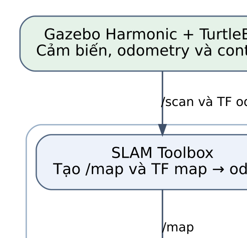
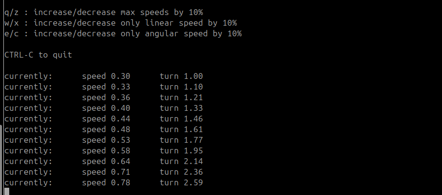
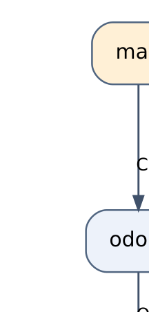
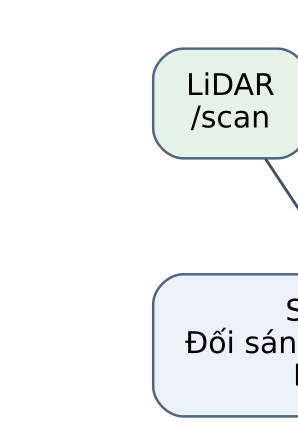
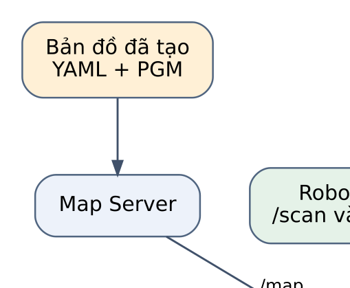
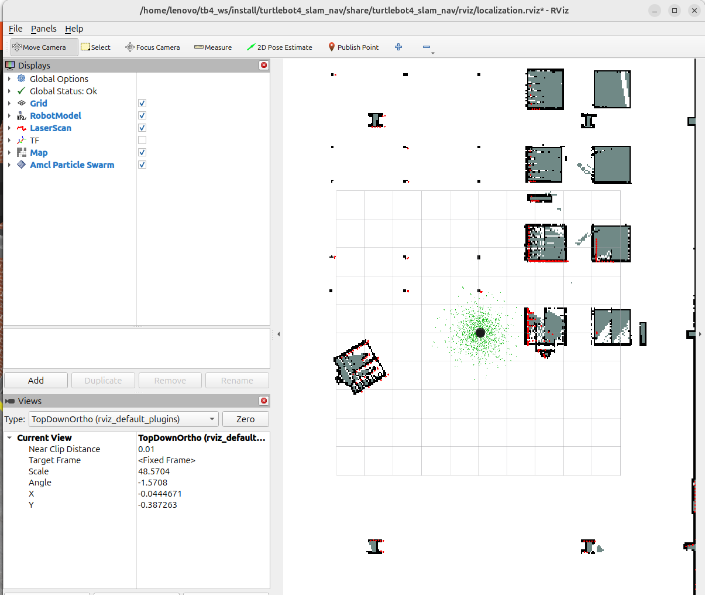
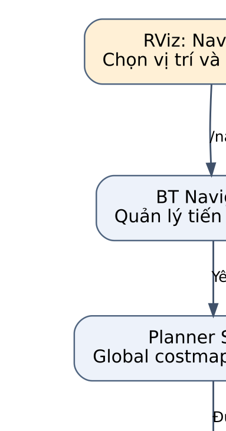
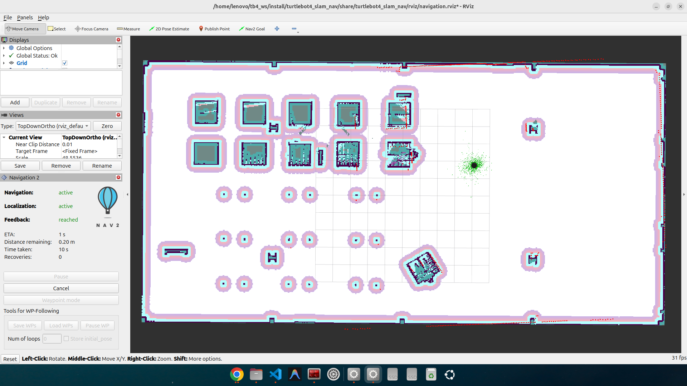

# KHUNG BÁO CÁO BÀI THỰC HÀNH 04

**Đề tài:** Mô phỏng TurtleBot 4, xây dựng bản đồ bằng SLAM Toolbox và điều hướng tự động với Nav2.

Khung này tham khảo cách tổ chức của `bthri.pdf`, được điều chỉnh theo dự án
`~/tb4_ws/src/turtlebot4_slam_nav`. Các đoạn `[ ... ]` là nội dung cần bổ sung.
Không dùng ảnh, tên sinh viên, world hoặc kết quả thực nghiệm của báo cáo mẫu
làm kết quả của mình. Lệnh thao tác đầy đủ nằm trong [README của dự án](../src/turtlebot4_slam_nav/README.md).

## Gợi ý trình bày

- Khổ A4, lề trái 3 cm; các lề còn lại khoảng 2–2.5 cm. Nếu lớp có mẫu quy định,
  dùng mẫu của lớp thay cho các gợi ý này.
- Font Times New Roman 12–13 pt, giãn dòng khoảng 1.3–1.5; mã lệnh dùng font monospace 9–10 pt.
- Đánh số mục, hình và bảng liên tục; dùng caption/cross-reference tự động trong Word hoặc LaTeX.
- Mỗi hình phải được nhắc đến trong nội dung trước hoặc gần vị trí đặt hình.
  Với sơ đồ/ảnh chụp, đặt chú thích dưới hình; cách đặt chú thích bảng theo quy định của lớp.
- Sơ đồ chỉ giữ thành phần cần giải thích, mũi tên có tên dữ liệu/topic, chữ không chồng lên đường nối.
- Mỗi phần thực hành trình bày theo thứ tự: **mục đích → cách thực hiện → bằng chứng → nhận xét**.
- Không biến báo cáo thành bản sao README: chỉ đưa các lệnh chính và giải thích vai trò của chúng.
- Dự kiến 10–13 trang gồm bìa, mục lục và tài liệu tham khảo; điều chỉnh theo số ảnh và yêu cầu giảng viên.

## Trang bìa

```text
[TÊN TRƯỜNG]
[TÊN KHOA / BỘ MÔN]

BÁO CÁO BÀI THỰC HÀNH 04

MÔ PHỎNG TURTLEBOT 4,
XÂY DỰNG BẢN ĐỒ BẰNG SLAM TOOLBOX
VÀ ĐIỀU HƯỚNG TỰ ĐỘNG VỚI NAV2

Học phần: [Tên học phần]
Giảng viên hướng dẫn: [Họ tên]
Sinh viên thực hiện: [Họ tên]
Mã sinh viên: [MSSV]
Lớp: [Tên lớp]

[Địa điểm], [Tháng/năm]
```

Sau bìa: mục lục tự động. Có thể thêm danh mục hình/bảng nếu mẫu của lớp yêu cầu.

---

# 1. Tổng quan đề tài và cấu trúc chương trình

*Dung lượng gợi ý: khoảng 1 trang.*

## 1.1. Mục tiêu bài thực hành

Viết một đoạn ngắn nêu bốn mục tiêu:

1. Khởi chạy TurtleBot 4, kiểm tra cảm biến, odometry, lệnh vận tốc và RViz2.
2. Điều khiển khảo sát môi trường, xây dựng và lưu bản đồ bằng SLAM Toolbox.
3. Khởi động lại trong cùng world, tải bản đồ và định vị bằng AMCL.
4. Dùng Nav2 để robot tự đi tới ba mục tiêu ở các khu vực khác nhau.

**Đoạn mở đầu có thể dùng:**

> Bài thực hành triển khai TurtleBot 4 trong môi trường mô phỏng trên Ubuntu 24.04,
> ROS 2 Jazzy và Gazebo Harmonic. Hệ thống sử dụng các package chính thức của
> TurtleBot 4 để kiểm tra robot, xây dựng bản đồ bằng SLAM Toolbox, định vị trên
> bản đồ đã lưu bằng AMCL và thực hiện điều hướng tự động với Nav2. Môi trường
> khảo sát là [world thực tế đã sử dụng].

## 1.2. Môi trường thực hiện

**Bảng 1. Môi trường phần mềm và mô phỏng.**

| Thành phần | Nội dung |
|---|---|
| Hệ điều hành | Ubuntu 24.04 |
| ROS 2 | Jazzy |
| Gazebo | Harmonic; bổ sung phiên bản thực tế nếu cần |
| Robot | TurtleBot 4 [Standard/Lite thực tế đã dùng] |
| World | [Xác nhận: depot hoặc world khác đã sử dụng xuyên suốt] |
| Workspace/package | `~/tb4_ws` / `turtlebot4_slam_nav` |
| Bản đồ dùng cho nghiệm thu | [Ví dụ: `depot_02.yaml` + `depot_02.pgm`] |

Không ghi ROS 2 Humble, Gazebo Fortress hay `simple_square` theo báo cáo mẫu:
đó là môi trường của tác giả mẫu, không phải cấu hình của dự án này.

## 1.3. Cấu trúc và cách tổ chức mã nguồn

```text
turtlebot4_slam_nav/
├── launch/
│   ├── simulation.launch.py
│   ├── mapping.launch.py
│   ├── localization.launch.py
│   └── navigation.launch.py
├── turtlebot4_slam_nav/
│   ├── launch_helpers.py
│   └── map_utils.py
├── config/fastdds_local.xml
├── rviz/                         # Cau hinh hien thi tung che do
├── scripts/
│   ├── env.sh
│   └── save_map.sh
├── maps/                         # YAML va PGM do sinh vien tao
├── package.xml
├── setup.py
└── README.md
```

Giải thích trong 4–6 câu: package tổ chức bốn launch wrapper, tái sử dụng
simulator/bridge/controller và launch chính thức; các chế độ thay thế nhau.
Mapping dùng SLAM; localization/navigation dùng AMCL, không chạy đồng thời
SLAM và AMCL. Các node xử lý mô phỏng dùng `use_sim_time=true`.
Không mô tả `run.sh`, world tự xây dựng hoặc YAML SLAM riêng nếu dự án không có chúng.

---

# 2. Các thành phần chính và kiến trúc hệ thống

*Dung lượng gợi ý: khoảng 1–1.5 trang.*

## 2.1. Package và node chính

**Bảng 2. Vai trò của các thành phần.**

| Package/node | Vai trò trong bài |
|---|---|
| `turtlebot4_gz_bringup`, `ros_gz_bridge` | Khởi tạo mô phỏng; chuyển dữ liệu/lệnh giữa Gazebo và ROS 2 |
| `slam_toolbox` | Nhận scan và TF odometry, tạo `/map` và TF `map → odom` khi mapping |
| `map_server`, `amcl` | Nạp bản đồ; ước lượng pose và cung cấp TF `map → odom` khi localization/navigation |
| `planner_server`, `controller_server`, `bt_navigator` | Lập đường đi, tính điều khiển và quản lý tiến trình goal |
| `velocity_smoother`, `collision_monitor` | Xử lý lệnh vận tốc trên đường đi tới robot |
| `motion_control`, `diffdrive_controller` | Tiếp nhận lệnh vận tốc và điều khiển robot mô phỏng |
| `rviz2`, `teleop_twist_keyboard` | Quan sát/đặt pose, goal; điều khiển bằng bàn phím khi khảo sát |

## 2.2. Topic và action quan trọng

**Bảng 3. Dữ liệu trao đổi giữa các thành phần.**

| Topic/action | Kiểu hoặc nội dung | Mục đích kiểm tra |
|---|---|---|
| `/scan` | `sensor_msgs/msg/LaserScan` | Dữ liệu khoảng cách LiDAR |
| `/odom` | `nav_msgs/msg/Odometry` | Vị trí/hướng và vận tốc theo odometry |
| `/cmd_vel` | `geometry_msgs/msg/TwistStamped` | Lệnh vận tốc đi tới `motion_control` |
| `/clock` | `rosgraph_msgs/msg/Clock` | Thời gian mô phỏng |
| `/map` | `nav_msgs/msg/OccupancyGrid` | Bản đồ chiếm chỗ |
| `/tf`, `/tf_static` | Biến đổi hệ tọa độ | Liên kết map, odom, thân robot và LiDAR |
| `/amcl_pose` | `geometry_msgs/msg/PoseWithCovarianceStamped` | Pose do AMCL ước lượng |
| `/plan` | `nav_msgs/msg/Path` | Đường đi toàn cục |
| `/navigate_to_pose` | Action `nav2_msgs/action/NavigateToPose` | Gửi và theo dõi navigation goal |

## 2.3. Sơ đồ tổng thể



**Hình 1. Luồng thực hiện mapping, lưu bản đồ và điều hướng trên bản đồ đã tạo.**

Viết 4–5 câu giải thích hình: SLAM xây dựng bản đồ ở giai đoạn khảo sát; bản đồ
được lưu thành YAML/PGM. Sau khi dừng SLAM, map server và AMCL sử dụng bản đồ
đó để định vị; Nav2 nhận goal và điều khiển robot. Sơ đồ biểu diễn các giai đoạn
kế tiếp nhau, không có nghĩa SLAM và AMCL chạy đồng thời.

---

# 3. Mô phỏng TurtleBot 4 và kiểm tra hoạt động

*Dung lượng gợi ý: khoảng 2 trang.*

## 3.1. Khởi chạy mô phỏng

Nêu mục đích kiểm tra robot trước khi SLAM; mô tả world thực tế và vị trí spawn.
Không tự ghi kích thước world nếu chưa đo hoặc chưa có tài liệu xác nhận.

```bash
source ~/tb4_ws/src/turtlebot4_slam_nav/scripts/env.sh
ros2 launch turtlebot4_slam_nav simulation.launch.py \
  world:=depot gui_render_engine:=ogre2
```

Nếu đã dùng engine/world khác, sửa câu lệnh theo phiên quay video thực tế.
Giải thích Gazebo mô phỏng vật lý/cảm biến, bridge chuyển sang ROS 2; RViz dùng
fixed frame `odom` khi chưa có bản đồ.

**Hình 2 cần chèn:** (a) robot/world trong Gazebo; (b) RobotModel và LaserScan
trên RViz2. Dùng ảnh của phiên thực nghiệm của mình.

## 3.2. Kiểm tra `/scan`, `/odom` và `/cmd_vel`

Đưa các lệnh đại diện, sau đó phân tích ảnh/log; không chỉ liệt kê lệnh:

```bash
ros2 topic info /scan -v
ros2 topic echo /scan sensor_msgs/msg/LaserScan \
  --once --qos-reliability best_effort
ros2 topic echo /odom nav_msgs/msg/Odometry --once
ros2 topic info /cmd_vel -v
```

Ở terminal B, sau khi undock nếu đang dock:

```bash
ros2 run teleop_twist_keyboard teleop_twist_keyboard --ros-args \
  -p stamped:=true -p use_sim_time:=true -p frame_id:=base_link \
  -p speed:=0.30 -p turn:=1.0
```

Ở terminal C đọc lệnh trong khi nhấn phím ở B:

```bash
ros2 topic echo /cmd_vel geometry_msgs/msg/TwistStamped \
  --qos-reliability best_effort
```

**Bảng 4. Kiểm tra hoạt động cơ bản của robot.**

| Nội dung | Tiêu chí | Quan sát thực tế | Bằng chứng |
|---|---|---|---|
| Robot/world | Robot xuất hiện, mô phỏng chạy | [Điền] | [Hình/log] |
| `/scan` | Có publisher và dữ liệu khoảng cách hợp lý | [Điền] | [Hình/log] |
| `/odom` | Pose thay đổi khi robot di chuyển | [Điền] | [Hình/log] |
| `/cmd_vel` | Có TwistStamped và subscriber; robot phản hồi lệnh | [Điền] | [Hình/log] |
| RViz2 | Hiển thị robot và LiDAR đúng TF | [Điền] | [Hình/log] |

**Hình 3 cần chèn:** ảnh kiểm tra `/scan` và `/odom`, có thể ghép (a), (b).


**Hình 4(a). Giao diện teleop và thao tác thay đổi giá trị đặt tốc độ.**
Ảnh đã nhận chỉ thể hiện giao diện teleop; cần bổ sung Hình 4(b) có dữ liệu
`/cmd_vel` khi nhấn phím, kèm quan sát chuyển động hoặc odometry.
Có message `/cmd_vel` chưa đủ chứng minh robot chuyển động; phải đối chiếu
odometry và robot trong Gazebo.

## 3.3. Cây TF và nhận xét



**Hình 5. Chuỗi TF rút gọn dùng cho robot và LiDAR.**

Giải thích: simulation mới có chuỗi từ `odom`; SLAM hoặc AMCL bổ sung
`map → odom` ở các giai đoạn tương ứng. Với robot Standard không namespace,
frame scan đã kiểm tra là `turtlebot4/rplidar_link/rplidar`; nếu phiên thực tế
khác, dùng frame trong header `/scan` để sửa hình.

**Đoạn nhận xét điền theo bằng chứng:**

> Qua các phép kiểm tra, [mô tả dữ liệu LiDAR], [mô tả sự thay đổi odometry] và
> [mô tả phản hồi điều khiển]. Chuỗi TF [kết quả kiểm tra]. Vì vậy, hệ thống
> [đã/chưa] đáp ứng điều kiện để chuyển sang giai đoạn xây dựng bản đồ.

---

# 4. Xây dựng và lưu bản đồ bằng SLAM Toolbox

*Dung lượng gợi ý: khoảng 1.5–2 trang.*

## 4.1. Nguyên lý và luồng dữ liệu

Giải thích ngắn: SLAM ước lượng pose đồng thời tạo bản đồ; LiDAR cung cấp hình
học môi trường, TF odometry cung cấp quan hệ chuyển động. Đối sánh scan và
loop closure giúp ràng buộc/tối ưu các pose khi quay lại vùng đã khảo sát.
Không cần trình bày công thức thuật toán dài nếu đề không yêu cầu.



**Hình 6. Đầu vào, đầu ra và bước lưu bản đồ của SLAM Toolbox.**

Chú ý: node SLAM dùng scan và TF; không viết rằng nó trực tiếp subscribe
`/odom` nếu chưa kiểm tra. `/odom` vẫn là topic quan trọng để kiểm tra robot.

## 4.2. Quy trình khảo sát

```bash
ros2 launch turtlebot4_slam_nav mapping.launch.py \
  world:=depot gui_render_engine:=ogre2
```

Mô tả việc dừng simulation cũ, undock, teleop khảo sát, đi qua hành lang và vùng
khuất, quay lại vùng đã đi. Bổ sung tuyến khảo sát thực tế: `[các khu vực đã đi]`.
RViz dùng fixed frame `map`; map cập nhật theo dữ liệu thu được.

**Hình 7 cần chèn:** (a) map trong quá trình khảo sát; (b) map sau khảo sát.
Ảnh map cuối phải đủ lớn để đánh giá tường, hành lang và vật cản.

## 4.3. Lưu map và đánh giá chất lượng

Lưu khi mapping vẫn chạy:

```bash
ros2 run turtlebot4_slam_nav save_map.sh "$HOME/tb4_ws/src/turtlebot4_slam_nav/maps/depot_02"
```

Lệnh chỉ là minh họa cách lưu; nếu `depot_02` đã tồn tại, script từ chối ghi đè.
Không chạy lại để thay kết quả đã có; chọn tên mới nếu cần lưu phiên mới.

Mô tả `*.pgm` chứa ảnh occupancy map; `*.yaml` chứa ảnh tham chiếu, resolution,
origin và các ngưỡng phân loại. Dùng đúng tên file mình đã tạo.

**Bảng 5. Thông số bản đồ thực nghiệm.**

| Thuộc tính | Giá trị cần ghi |
|---|---|
| YAML/ảnh | [Tên file map của bài] |
| Kích thước ảnh | [Chiều rộng × chiều cao, đơn vị ô/pixel] |
| Độ phân giải | [m/ô] |
| Origin | [x, y, yaw] |
| Ngưỡng free/occupied | [Giá trị từ YAML] |

**Thông tin đã đọc từ file của dự án khi soạn khung (13/10/2026):**
`depot_02.yaml` tham chiếu `depot_02.pgm`; ảnh 602 × 302 pixel; resolution
0.050 m/ô; origin `[-15.117, -7.709, 0]`; free threshold 0.196;
occupied threshold 0.65. Chỉ dùng các giá trị này nếu đây là map cuối cùng
được chọn để nghiệm thu; chúng không chứng minh mức độ bao phủ hoặc chất lượng SLAM.

Nhận xét cần dựa trên ảnh: tường rõ hay bị nhân đôi, hành lang có liên tục không,
vật cản chính có được thể hiện không, còn vùng nào chưa khảo sát. Không suy ra
"khảo sát phần lớn môi trường" chỉ từ kích thước ảnh map.

---

# 5. Localization trên bản đồ đã lưu

*Dung lượng gợi ý: khoảng 1–1.5 trang.*

## 5.1. Khởi động lại và khởi tạo pose

Sau khi lưu map, dừng mapping/SLAM, khởi động lại trong cùng world:

```bash
ros2 launch turtlebot4_slam_nav localization.launch.py \
  world:=depot gui_render_engine:=ogre2 \
  map:="$HOME/tb4_ws/src/turtlebot4_slam_nav/maps/depot_02.yaml"
```

Giải thích map server nạp map; AMCL dùng bản đồ, scan và thông tin chuyển động
để ước lượng pose. Undock robot mới, dùng **2D Pose Estimate** tại vị trí hiện
thời và kéo đúng hướng. Tọa độ map không nhất thiết trùng tọa độ world Gazebo.



**Hình 8. Luồng định vị trên bản đồ đã lưu bằng map server và AMCL.**

## 5.2. Kiểm chứng vị trí robot

```bash
ros2 lifecycle get /map_server
ros2 lifecycle get /amcl
ros2 topic echo /amcl_pose geometry_msgs/msg/PoseWithCovarianceStamped --once
ros2 run tf2_ros tf2_echo map base_link --ros-args -p use_sim_time:=true
```



**Hình 9(a). Hiển thị bản đồ, mô hình robot, LiDAR và tập hạt AMCL trong RViz.**
Ảnh có `Global Status: Ok`. Cần bổ sung Hình 9(b) là robot trong Gazebo ở cùng
trạng thái, đánh dấu đặc điểm môi trường tương ứng để kiểm chứng vị trí/hướng.
Không kết luận pose chính xác chỉ vì giao diện hiển thị tập hạt.

Nhận xét: `[map server/AMCL active]`, `[TF đã có]`, `[mức độ khớp scan-map]`,
`[sai lệch hoặc thao tác đặt lại pose nếu có]`. Không kết luận định vị đúng chỉ
vì xuất hiện log `Setting pose`.

---

# 6. Điều hướng tự động bằng Nav2

*Dung lượng gợi ý: khoảng 1.5–2 trang.*

## 6.1. Khởi chạy và luồng điều hướng

Dừng localization cũ rồi chạy:

```bash
ros2 launch turtlebot4_slam_nav navigation.launch.py \
  world:=depot gui_render_engine:=ogre2 \
  map:="$HOME/tb4_ws/src/turtlebot4_slam_nav/maps/depot_02.yaml"
```

Undock, đặt initial pose cho robot mới; kiểm tra Nav2 active và thoát teleop
trước goal đầu tiên. Phân biệt **2D Pose Estimate** (vị trí hiện tại) và
**Nav2 Goal** (đích cần robot tự đi tới).



**Hình 10. Luồng xử lý goal, lập kế hoạch và lệnh vận tốc của Nav2.**

Giải thích planner lập đường đi theo global costmap, controller tính lệnh theo
trạng thái robot/local costmap, BT navigator quản lý tiến trình. Lệnh đi qua
velocity smoother, collision monitor và bộ điều khiển robot chính thức.

## 6.2. Thực nghiệm ba goal

Mô tả tiêu chí chọn goal: vùng trống đã khảo sát, ba khu vực khác nhau, tránh
sát tường. Gửi từng goal bằng RViz, chờ hoàn thành rồi gửi goal tiếp theo;
không điều khiển thủ công sau khi gửi goal.

```bash
ros2 topic echo /navigate_to_pose/_action/status action_msgs/msg/GoalStatusArray
```

**Bảng 6. Kết quả navigation ở ba mục tiêu.**

| Goal | Khu vực/tọa độ và hướng đích | Trạng thái cuối | Va chạm quan sát | Mốc video |
|---|---|---|---|---|
| 1 | [Điền] | [SUCCEEDED/ABORTED/...] | [Có/không/chưa xác nhận] | [Điền] |
| 2 | [Điền] | [Điền] | [Điền] | [Điền] |
| 3 | [Điền] | [Điền] | [Điền] | [Điền] |



**Hình 11(a), tạm thời. Giao diện Nav2 hiển thị Navigation và Localization active,
Feedback reached sau một goal.**
Chưa xác định đây là goal thứ mấy; xác nhận thứ tự trước khi điền Bảng 6.
Cần bổ sung hai goal tại các khu vực khác để có Hình 11(b), (c).
Nếu ghép ba ảnh làm chữ quá nhỏ, chia thành hai hình hoặc dùng ba hàng.
Kèm log/status hoặc mốc video để chứng minh từng goal đã thành công.
Theo dõi đúng goal UUID; `status: 4` của một goal cũ không chứng minh goal mới đã hoàn thành.

## 6.3. Nhận xét

Viết dựa trên thực nghiệm: robot có tự lập kế hoạch/đi đến goal không, đoạn nào
đi sát vật cản, có replanning hoặc goal thất bại không. Nếu ghi thời gian thực
hiện, nêu rõ thời gian mô phỏng hay thời gian thực và cách đo. Chỉ ghi "không
va chạm" khi có quan sát/video hỗ trợ.

---

# 7. Kết quả tổng hợp, hạn chế và kết luận

*Dung lượng gợi ý: khoảng 0.5–1 trang.*

## 7.1. Đối chiếu với yêu cầu bài tập

**Bảng 7. Tổng hợp mức độ hoàn thành.**

| Yêu cầu | Kết quả thực tế | Minh chứng |
|---|---|---|
| Robot và các topic cơ bản hoạt động | [Đạt/chưa đạt] | [Hình/log] |
| RViz hiển thị robot/LiDAR | [Điền] | [Hình] |
| Khảo sát phần lớn vùng đi được, map rõ | [Điền] | [Map + video] |
| Lưu bản đồ YAML/PGM | [Điền] | [Tên file] |
| Dừng SLAM và localization trên map đã lưu | [Điền] | [TF/AMCL + ảnh đối chiếu] |
| Ba goal khác khu vực, tự đi không va chạm | [Điền] | [Status + video] |

## 7.2. Vấn đề gặp phải và cách xử lý

Chọn các lỗi thực sự đã gặp, trình bày ngắn theo **hiện tượng → nguyên nhân
đã xác minh/giả thuyết → thao tác → kết quả**. Có thể đề cập:

- GUI Gazebo trắng/đen hoặc crash; engine đã thử và giới hạn còn lại.
- Scan cố định 0.164 m; cách chọn sensor engine và kết quả kiểm tra scan.
- AMCL chờ initial pose, scan bị giữ khi thiếu TF.
- Phân biệt pose estimate với navigation goal và dùng đúng launch navigation.

Tách "đã xử lý" khỏi "chưa khắc phục". Không viết đã sửa hoàn toàn lỗi GUI
nếu chỉ chuyển sang chạy server không GUI.

## 7.3. Kết luận và liên kết nộp bài

**Khung đoạn kết luận:**

> Qua bài thực hành, hệ thống đã [liệt kê những yêu cầu có bằng chứng đạt].
> Bản đồ [tên map] được sử dụng để [kết quả localization thực tế]. Thử nghiệm
> điều hướng tại [số goal thực tế thành công] mục tiêu cho thấy [nhận xét].
> Các hạn chế còn lại gồm [liệt kê].

GitHub mã nguồn: **[Tự bổ sung]**

Google Drive video: **[Tự bổ sung]**

---

# Tài liệu tham khảo

Dùng cùng một kiểu trích dẫn (ví dụ [1], [2], ...), dẫn tại nơi giải thích
thành phần/thuật toán. Không tự ghi tác giả, năm hoặc ngày truy cập chưa xác minh.

1. TurtleBot 4 User Manual — Simulator: https://turtlebot.github.io/turtlebot4-user-manual/software/turtlebot4_simulator.html
2. TurtleBot 4 User Manual — Generate Map: https://turtlebot.github.io/turtlebot4-user-manual/tutorials/generate_map.html
3. TurtleBot 4 User Manual — Navigation: https://turtlebot.github.io/turtlebot4-user-manual/tutorials/navigation.html
4. TurtleBot 4 Simulator, nhánh Jazzy: https://github.com/turtlebot/turtlebot4_simulator/tree/jazzy
5. Báo cáo tham khảo `bthri.pdf`: bổ sung thông tin tài liệu theo yêu cầu của lớp nếu sử dụng ý tưởng/nội dung từ tài liệu này.

## Danh sách sơ đồ và cách dùng

Năm sơ đồ đã có trong `reports/so_do/`, mỗi sơ đồ gồm `.svg`, `.png` và `.dot`:

| File | Vị trí trong báo cáo | Nội dung |
|---|---|---|
| `01_tong_the` | Mục 2.3, Hình 1 | Các giai đoạn và quan hệ dữ liệu tổng thể |
| `02_tf` | Mục 3.3, Hình 5 | Chuỗi frame, nguồn tạo TF theo từng chế độ |
| `03_slam` | Mục 4.1, Hình 6 | Scan/TF vào SLAM, map và file bản đồ đầu ra |
| `04_localization` | Mục 5.1, Hình 8 | Map server + AMCL và đầu ra định vị |
| `05_navigation` | Mục 6.1, Hình 10 | Goal → Nav2 → luồng vận tốc → robot |

Dùng SVG khi phần mềm soạn thảo hỗ trợ để chữ rõ khi phóng to; dùng PNG nếu cần
chèn ảnh thông thường. File DOT là nguồn chỉnh sửa. Các sơ đồ là minh họa kiến
trúc, không phải ảnh minh chứng chạy thành công. Chỉnh caption/số hình nếu thêm
hoặc bớt ảnh; kiểm tra cuối cùng không còn `[Điền]`, `Hình ??` hoặc tham chiếu hỏng.

Ảnh người thực hiện đã gửi và giới hạn bằng chứng được ghi tại
[ghi chú ảnh](anh/ghi_chu_anh.md). Ba ảnh đã nhận được chèn ở mục 3.2, 5.2 và 6.2;
các mục còn lại vẫn là khung chờ bổ sung kết quả thực nghiệm.
